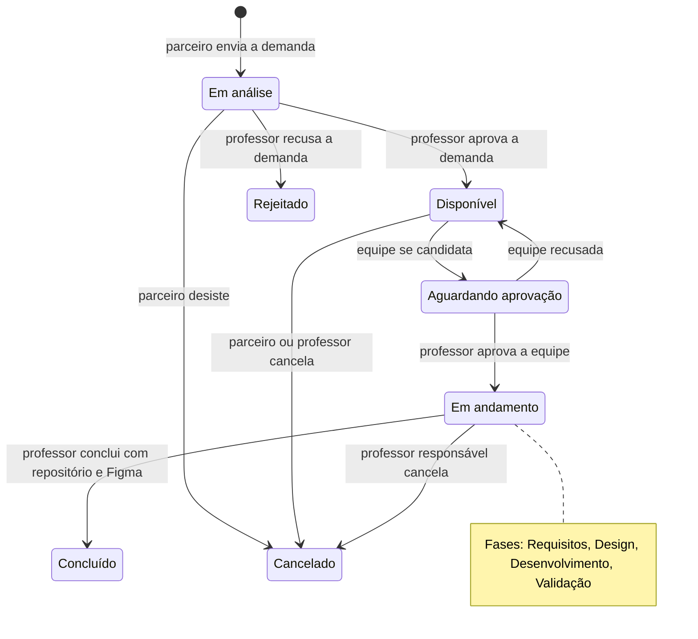
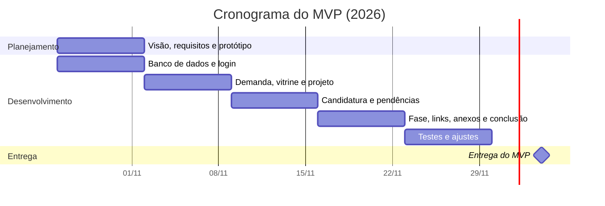

# Documento de Visão: Conectando Social UFC

Versão de 16/11/2026.

O Conectando Social UFC liga demandas da comunidade externa a equipes de disciplinas extensionistas da UFC e guarda o que cada projeto produziu. O MVP fica pronto até o início de dezembro de 2026. Ele precisa mostrar o ciclo completo: demanda enviada, equipe aprovada, fases atualizadas e projeto concluído com repositório e Figma registrados.

## Problema e posicionamento

Equipes de disciplinas extensionistas gastam o começo do semestre procurando um parceiro real, e o que produzem se perde quando a disciplina acaba ou o aluno sai da UFC.

### Declaração do problema

| Elemento | Descrição |
| --- | --- |
| O problema | Equipes não encontram parceiros reais, e os projetos ficam em contas pessoais que somem com o aluno |
| Afeta | Alunos e professores de disciplinas extensionistas e a comunidade externa |
| Impacto | Semanas perdidas procurando cliente, demandas da comunidade sem atendimento e código, protótipos e documentos sem dono |
| Uma boa solução | Um portal onde a comunidade registra demandas, equipes as assumem com um professor responsável e as entregas ficam registradas |

### Posicionamento do produto

| Elemento | Descrição |
| --- | --- |
| Para | Professores e alunos de disciplinas extensionistas da UFC e parceiros da comunidade |
| Que precisam | Ligar demandas reais a equipes e guardar o que foi produzido |
| O Conectando Social UFC | É um portal de demandas e de acompanhamento de projetos de extensão |
| Diferente de | Plataformas de freelance como o Workana, pagas e individuais, e de grupos de WhatsApp com repositórios pessoais |
| Nosso produto | É gratuito, organizado por equipe e disciplina, tem um professor responsável e guarda a memória de cada projeto |

## Envolvidos e usuários

A prof. Leonara é a stakeholder principal: define as necessidades e valida requisitos, protótipo e MVP.

| Envolvido | Papel |
| --- | --- |
| Prof. Leonara (Projeto Integrado 1 e 3) | Stakeholder principal; valida requisitos, protótipo e MVP |
| Prof. Sidartha (Web 2) | Avalia o trabalho final |
| Henrique | Requisitos, protótipo no Figma e validação com a stakeholder |
| Rodrigo Rodrigues, Vitória Rabelo e Yuri Oliveira | Desenvolvimento; Rodrigo montou o repositório e o ambiente |

| Perfil | Quem é | O que faz no MVP | Conta |
| --- | --- | --- | --- |
| Visitante | Qualquer pessoa | Consulta a vitrine e os projetos | Não precisa |
| Aluno | Estudante da UFC em disciplina extensionista | Candidata a equipe e atualiza o projeto da equipe | Autocadastro |
| Professor | Docente de disciplina extensionista | Revisa demandas, aprova equipes, registra o repositório e conclui projetos | Criada pela equipe técnica |
| Parceiro | Pessoa que representa uma organização da comunidade | Envia demandas e acompanha o status de cada uma | Autocadastro, com aceite do termo |

Parceiros da comunidade são ONGs, associações e coletivos, pequenos negócios e MEIs, escolas, outras instituições de ensino, órgãos públicos e setores da UFC. No MVP eles criam conta para enviar demandas e acompanhar cada uma; a conversa com a equipe acontece por e-mail ou WhatsApp.

## Necessidades

Todos os pedidos do áudio da stakeholder entram no MVP; a última coluna aponta o requisito que atende cada um.

| # | Necessidade | Origem | Como o MVP atende |
| --- | --- | --- | --- |
| N1 | Ver os projetos separados em backlog, iniciados e finalizados | Stakeholder | Abas Disponíveis, Em andamento e Concluídos (RF08) |
| N2 | Saber a fase de cada projeto | Stakeholder | Fase atualizada pela equipe: Requisitos, Design, Desenvolvimento ou Validação (RF14) |
| N3 | Ter um professor responsável por projeto | Stakeholder | Professor indicado na candidatura e obrigatório para iniciar (RF11, RF12) |
| N4 | Saber quem é o responsável da comunidade | Stakeholder | Conta do parceiro ligada à demanda (RF01, RF04) |
| N5 | Ter uma descrição breve do projeto | Stakeholder | Formulário de demanda guiado (RF04) |
| N6 | Anexar arquivos, como o documento de requisitos | Stakeholder | Anexos por projeto (RF17) |
| N7 | Ver a equipe e a função de cada pessoa | Stakeholder | Membros com função (RF11, RF13) |
| N8 | Exigir link do Git e do Figma para finalizar | Stakeholder | Conclusão bloqueada sem os dois links (RF18) |
| N9 | Não perder o projeto quando o aluno sai da UFC | Stakeholder | Repositório no perfil do professor, com link registrado pelo professor (RF15) |
| N10 | Equipes encontrarem parceiros reais | Equipe | Vitrine pública de demandas (RF08, RF09) |
| N11 | Comunidade relatar problemas e acompanhar o andamento | Equipe | Conta de parceiro, formulário guiado e Minhas demandas (RF01, RF04, RF07) |
| N12 | Usar pelo celular | Equipe | Interface mobile first (RNF01, RNF02) |

## Ciclo de vida do projeto

Só chega a Concluído o projeto com repositório e Figma registrados.

Alunos só enviam a candidatura e mudam a fase. O parceiro pode desistir da própria demanda antes de ela começar; o resto fica com os professores.

## Escopo do MVP

O MVP cobre o ciclo inteiro de um projeto em 10 telas, com quatro perfis: visitante, aluno, professor e parceiro.

| Funcionalidade | O que faz | Quem usa |
| --- | --- | --- |
| Contas | Cadastro e login de aluno e de parceiro; contas de professor criadas por script; recuperação de senha por e-mail | Todos com conta |
| Formulário de demanda | O parceiro logado descreve o problema que quer resolver | Parceiro |
| Minhas demandas | O parceiro acompanha o status das próprias demandas e vê o motivo quando uma é rejeitada | Parceiro |
| Revisão de demandas | O professor aprova ou rejeita antes de a demanda aparecer na vitrine | Professor |
| Vitrine | Lista com abas Disponíveis, Em andamento e Concluídos | Todos |
| Página do projeto | Problema, parceiro, professor, equipe e funções, status, fase, links e anexos | Todos; contato e anexos só para alunos, professores e o parceiro do projeto |
| Candidatura de equipe | Membros, funções, professor responsável, disciplina e semestre | Aluno |
| Acompanhamento | Fase, link do Figma e anexos; o professor registra o repositório | Equipe e professor |
| Conclusão | Liberada só com os links do repositório e do Figma | Professor |
| Pendências | Demandas e candidaturas à espera do professor, numa tela | Professor |

## Fora do MVP

Os itens abaixo ficam fora para caber no prazo. A primeira lista pode entrar depois; a segunda não faz parte do produto.

### Fica para depois

- Parceiro aceitar a equipe e editar a demanda depois de enviada
- Continuidade entre semestres, com histórico de equipes
- Cópia do código (ZIP) obrigatória na entrega
- Notificações por e-mail (o único e-mail do MVP é o de recuperação de senha)
- Busca e filtro por área na vitrine
- Organização do GitHub da instituição para os repositórios
- Portfólio público do aluno e retorno do parceiro ao fim do projeto
- Deploy público: no MVP o sistema roda com Docker a partir do GitHub; a publicação vem depois

### Não faz parte do produto

- Preço, proposta ou pagamento: não há dinheiro envolvido
- Chat: a conversa com o parceiro acontece por e-mail ou WhatsApp
- Avaliações e rankings de alunos
- Certificados e contagem de horas: o registro oficial continua no SIGAA

## Restrições e decisões

O prazo de cinco semanas e a equipe de quatro pessoas definem o tamanho do MVP. As decisões abaixo foram confirmadas em 26/10.

| Tema | Decisão |
| --- | --- |
| Prazo | Fim de novembro ou início de dezembro de 2026; o plano mira 4/12 |
| Equipe | 4 pessoas |
| Tecnologia | React + Vite, Node + Express, Prisma + PostgreSQL e Docker Compose |
| Interface | Mobile first, com componentes do MUI (o mesmo kit usado no Figma) |
| Hospedagem | O código fica no GitHub e roda com Docker; sem deploy público no MVP; a publicação vem depois |
| Repositórios dos projetos | No perfil do professor responsável, que registra o link; no MVP aceita-se o perfil de um aluno |
| Critério das demandas | O da disciplina: o professor confirma. Demandas de setores da UFC entram |
| Parceiro | Tem conta: envia demandas e acompanha o status de cada uma |
| Canal de demandas da PREX | Considera-se que não existe; a plataforma é a porta de entrada das demandas |
| Dinheiro | Nenhum: é extensão, não freelance |
| SIGAA | A plataforma não o substitui: certificados e horas seguem no sistema oficial |

## Riscos

O maior risco é o prazo; os outros pesam no uso real, depois da disciplina.

| Risco | Impacto | Mitigação |
| --- | --- | --- |
| Prazo de cinco semanas | Alto | Escopo enxuto, banco e login em paralelo ao protótipo e ordem de corte definida no documento de requisitos |
| Poucas demandas cadastradas no uso real | Alto | Professores e alunos trazem parceiros para a plataforma; propor uma turma piloto de Projeto Integrado |
| Parceiro com pouca familiaridade digital desistir no cadastro | Médio | Cadastro curto, linguagem simples e telas pensadas para celular |
| Repositório no perfil de um aluno se perder | Médio | Aceito só no MVP; depois, exigir o perfil do professor ou o ZIP do código |
| Fase desatualizada | Médio | Data da última atualização visível em cada projeto |
| Parceiro esperar um produto pronto e mantido | Médio | Termo de ciência obrigatório no cadastro do parceiro |
| Exposição de dados pessoais (LGPD) | Médio | Contato do parceiro só para alunos, professores e o próprio parceiro; data do consentimento registrada |
| Plataforma presa na conta de um aluno depois da disciplina | Médio | Transferir o repositório da plataforma para o perfil de um professor |

## Cronograma

Cinco semanas de trabalho e entrega até 4 de dezembro; banco e login correm junto com o protótipo.

O plano mira 4/12 como último dia. Se a disciplina fixar outra data, a folga de 30/11 a 4/12 é a primeira a encolher.
